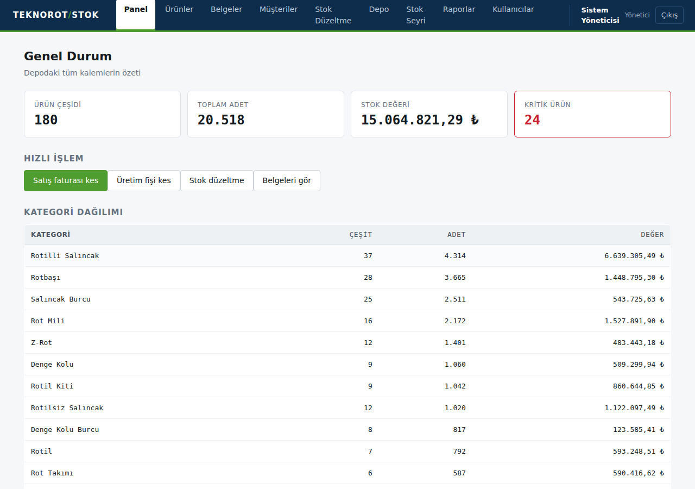
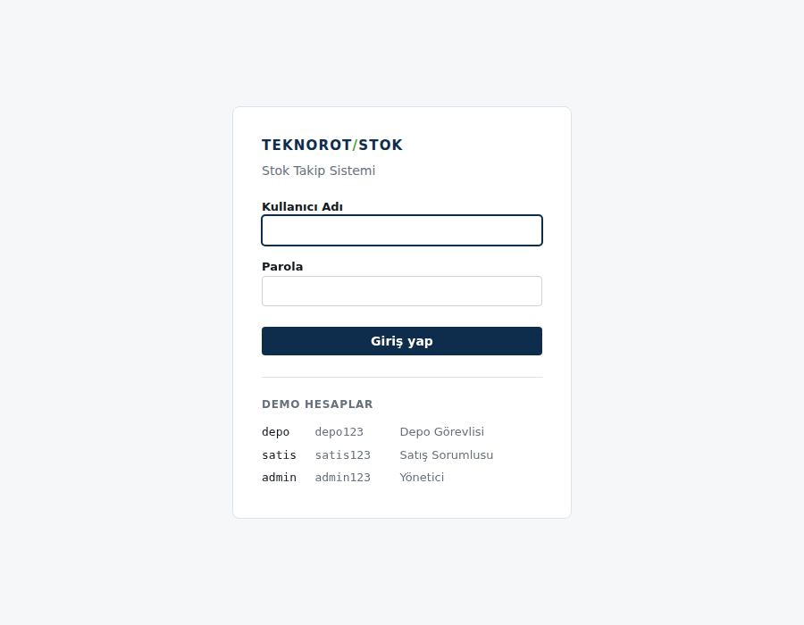
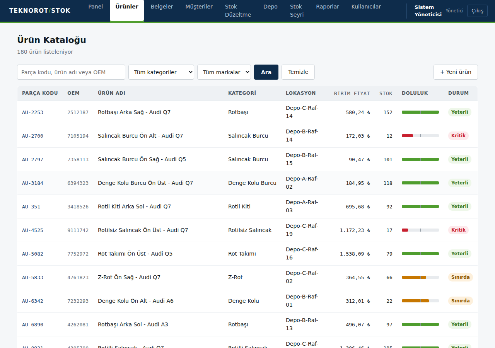
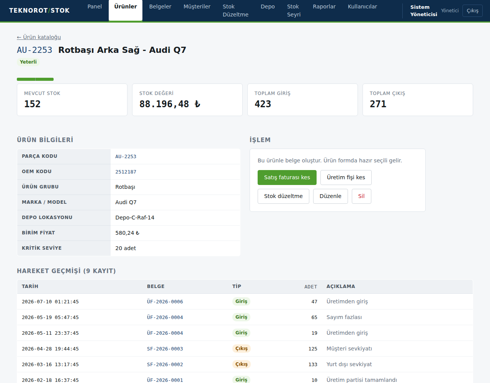
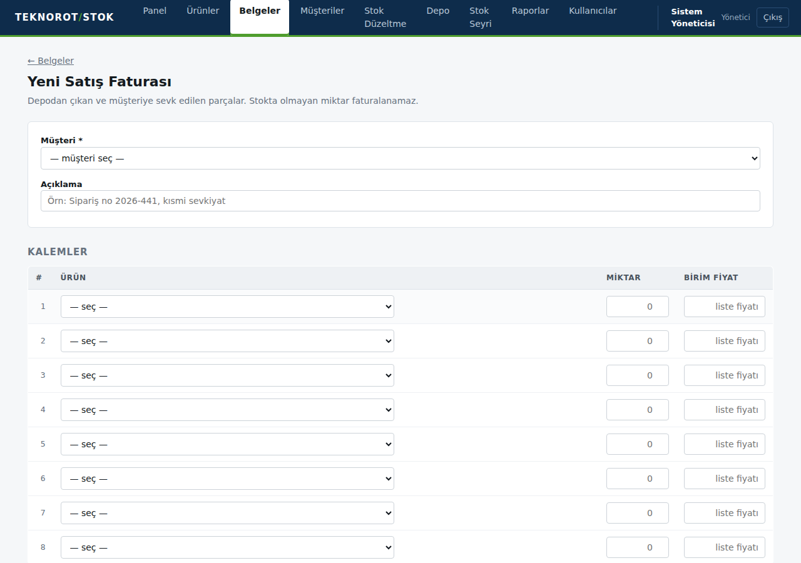
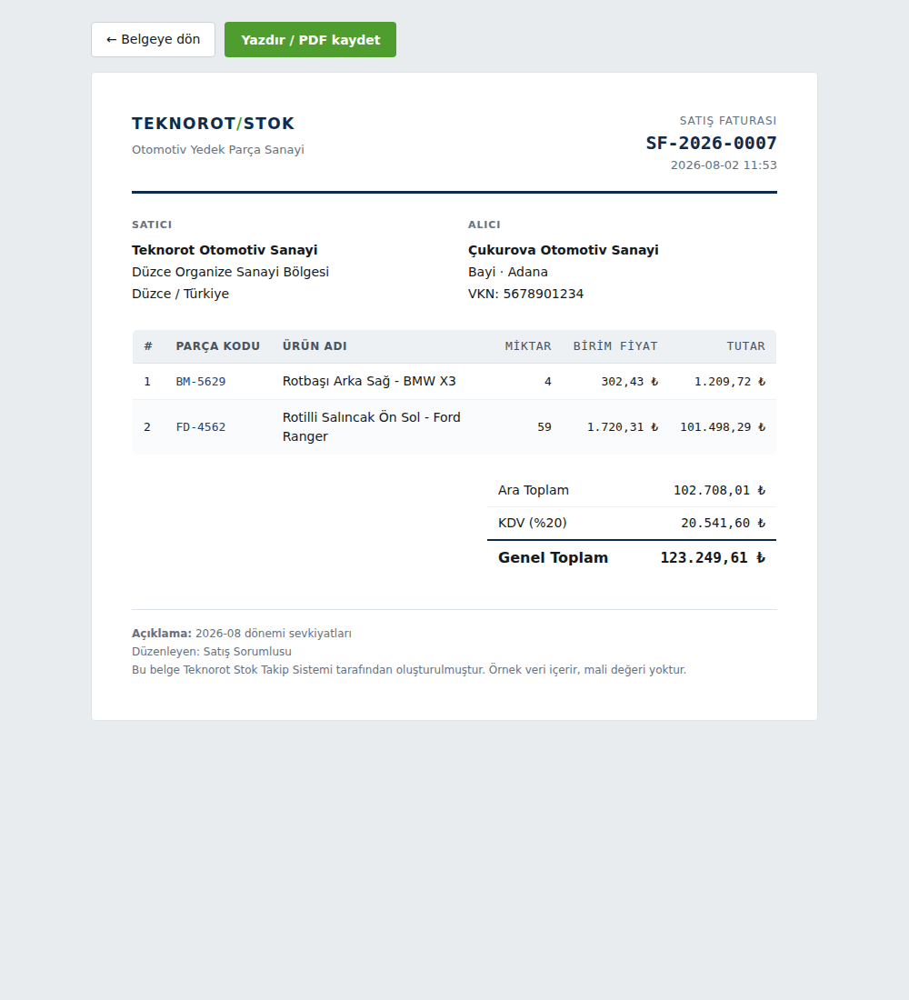
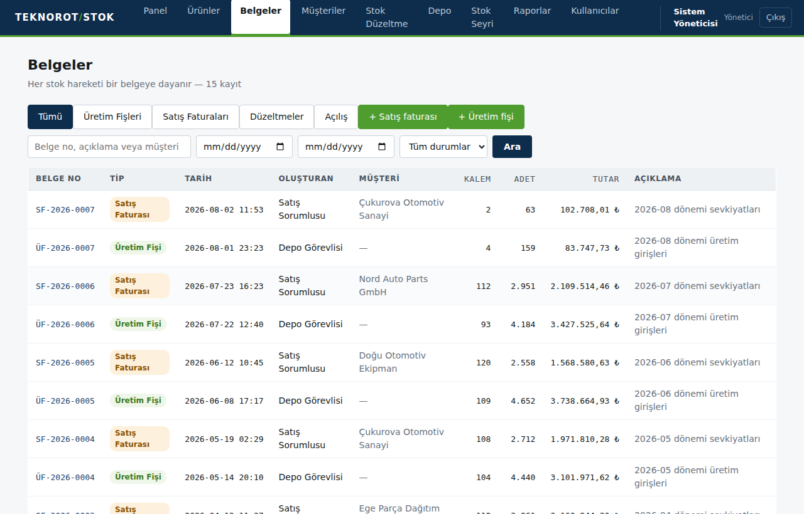
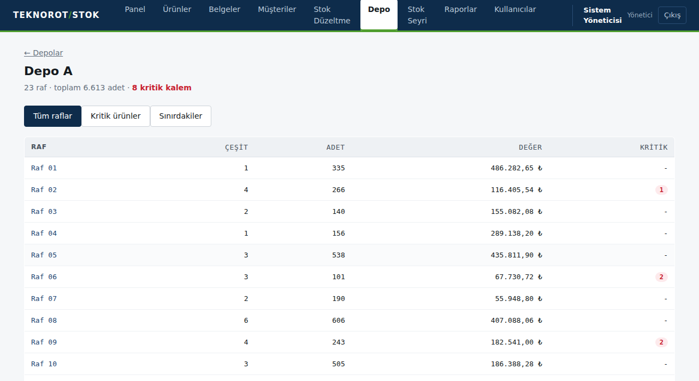
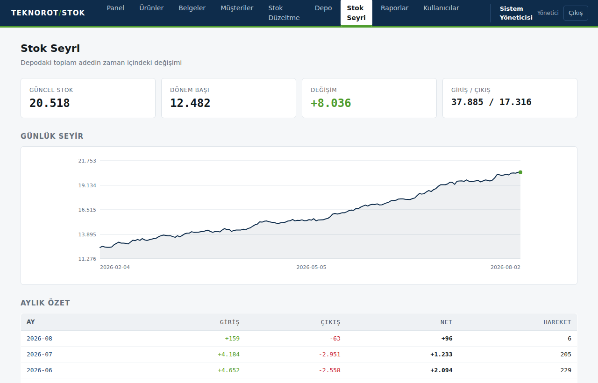

# Teknorot Stok Takip Sistemi — kurulumsuz sürüm

Otomotiv yedek parça (direksiyon ve süspansiyon grubu) stok takip paneli.

> Teknorot stajım sırasında geliştirdiğim öğrenme projesidir. Uygulamadaki
> ürün, müşteri ve stok verileri `seed.py` ile üretilmiş temsilî verilerdir;
> gerçek şirket verisi içermez.



**Hiçbir kütüphane kurulumu gerektirmez.** `pip install` yok, internet
bağlantısı gerekmez. Sadece Python'un kendisi yeterli (3.9 ve üzeri).

## Çalıştırma

```bash
python server.py
```

Tarayıcı kendiliğinden açılır. Açılmazsa adres çubuğuna `http://127.0.0.1:8000`
yaz. Durdurmak için terminalde `Ctrl+C`.

## Giriş

Uygulama kullanıcı adı ve parola ile girilir. Demo hesaplar:

| Kullanıcı | Parola | Rol |
|---|---|---|
| `depo` | `depo123` | Depo Görevlisi |
| `satis` | `satis123` | Satış Sorumlusu |
| `admin` | `admin123` | Yönetici |

Parolalar veritabanında düz metin olarak tutulmaz; PBKDF2-SHA256 ile
200.000 tur döndürülmüş, kullanıcıya özel tuz eklenmiş özet olarak saklanır.

### Roller ve yetkiler

| | Depo | Satış | Yönetici |
|---|---|---|---|
| Panel, ürün arama, belge görüntüleme | ✓ | ✓ | ✓ |
| Stok seyri grafiği | ✓ | ✓ | ✓ |
| Üretim fişi kesme | ✓ | — | ✓ |
| Stok düzeltme fişi | ✓ | — | ✓ |
| Depo ve raf raporu | ✓ | — | ✓ |
| Satış faturası kesme | — | ✓ | ✓ |
| Müşteri listesi | — | ✓ | ✓ |
| Kritik stok raporu, Excel çıktısı | — | ✓ | ✓ |
| Belge iptali | — | — | ✓ |
| İade faturası kesme | — | ✓ | ✓ |
| Ürün ekleme / düzenleme / silme | — | — | ✓ |
| Kullanıcı yönetimi | — | — | ✓ |
| Fiyat ve tutar görme | — | ✓ | ✓ |

Yetki kontrolü hem menüde hem adres seviyesinde uygulanır: yetkisiz bir
adrese doğrudan gidilmeye çalışıldığında 403 yanıtı döner. Aynı kontrol
form gönderimlerinde de geçerlidir.

Depo rolünün fiyat görmemesi bilinçlidir: depo işlemleri adet üzerinden
yürür, maliyet bilgisi bu rolü ilgilendirmez.

## Ekranlar

| Sayfa | İşlev |
|---|---|
| Panel | Ürün çeşidi, toplam adet, stok değeri, kritik ürün sayısı, kategori dağılımı |
| Ürünler | Parça kodu / ürün adı / OEM koduna göre arama, kategori ve marka filtresi |
| Belgeler | Tüm belgeler; üretim fişi ve satış faturası oluşturma, iptal, yazdırma |
| Müşteriler | Müşteri listesi ve müşteri bazlı satış özeti |
| Stok Düzeltme | Sayım farkı, fire, iade gibi istisnai düzeltmeler |
| Depo | Depo ve raf bazlı dağılım, kritik/sınırda süzme |
| Stok Seyri | Günlük stok grafiği ve aylık giriş-çıkış özeti |
| Raporlar | Kritik stok listesi, Excel / CSV indirme, PDF olarak yazdırma |
| Kullanıcılar | Kullanıcı ekleme, rol değiştirme, parola sıfırlama, hesap açma/kapama |

### Ekran görüntüleri

| Giriş | Ürünler |
|---|---|
|  |  |
| **Ürün detayı** | **Satış formu** |
|  |  |
| **Fatura** | **Belgeler** |
|  |  |
| **Depo** | **Stok seyri** |
|  |  |

## Dosya yapısı

| Dosya | Görevi |
|---|---|
| `server.py` | Web sunucusu ve arayüz — tek satır SQL içermez |
| `queries.py` | Tüm SQL sorguları |
| `db.py` | Bağlantı yönetimi ve tablo şeması |
| `exports.py` | Excel ve CSV üretimi |
| `auth.py` | Parola özeti ve oturum yönetimi |
| `seed.py` | Örnek veri ve demo kullanıcı üretici |
| `stok.db` | SQLite veritabanı (tek dosya) |

## Belge zinciri

Sistemdeki temel kural: **hiçbir stok hareketi belgesiz oluşmaz.**

| Belge | Ön ek | Etki | Kim keser |
|---|---|---|---|
| Üretim Fişi | ÜF | Stok girişi | Depo |
| Satış Faturası | SF | Stok çıkışı | Satış |
| İade Faturası | IF | Müşteriden dönen mal, stok girişi | Satış |
| Düzeltme Fişi | SY | Sayım farkı, fire, iade | Depo |
| Açılış Fişi | AF | Sistem devreye alma | (otomatik) |

Her hareket bir belgeye bağlıdır; "bu adet nereden geldi" sorusunun
cevabı her zaman bir belge numarasıdır. Düzeltme fişinde sebep serbest
metin değil, sabit listeden seçilir — böylece bir satış, düzeltme olarak
kaydedilemez.

Belgeler **silinmez, iptal edilir.** İptal edilen belge listede İPTAL
damgasıyla kalır ve etkisini geri almak için ters hareketler oluşturulur.
Bir üretim fişi, ürettiği mal kısmen satılmışsa iptal edilemez; sistem
bunu iptal öncesinde kontrol eder.

### İade akışı

İade, satışın işidir — müşteriyle anlaşan ve faturayı kesen odur. Akış:

1. Satış, iade faturası keser (`IF-2026-0001`). Hangi satış faturasından
   döndüğü zorunlu olarak belirtilir. Stok **otomatik artar.**
2. Depo malı fiziksel olarak teslim alıp kontrol eder.
3. Hasarlı çıkarsa depo, Stok Düzeltme ekranından **Fire / hurda ayrımı**
   fişi keser; stok düşer.

Böylece ticari karar (iade kabul edilsin mi) satışta, fiziksel karar
(mal satılabilir mi) depoda kalır.

Kurallar: satılandan fazla iade edilemez ve daha önce kesilen iadeler
hesaba katılır; faturada geçmeyen ürün iade edilemez; iptal edilmiş bir
satıştan iade alınamaz. Belge detayında satış ve iade faturaları
birbirine iki yönlü bağlıdır.

## Veri modeli

**products** — parça kodu, OEM kodu, ürün adı, kategori, araç marka/model,
birim fiyat, kritik seviye, depo lokasyonu

**stock_movements** — ürün, hareket tipi (giriş/çıkış), adet, tarih, açıklama

Mevcut stok `products` tablosunda **tutulmaz**; her sorguda hareketlerden
hesaplanır (`SUM(giriş) − SUM(çıkış)`). Aynı bilgiyi iki yerde tutmak,
zamanla ikisinin birbirinden ayrılmasına yol açar: biri güncellenir, diğeri
unutulur. Bu tasarımda hareket kayıtları tek doğruluk kaynağı, stok ise
türetilmiş bilgidir. Ayrıca her stok değişikliğinin denetlenebilir bir kaydı
kalır.

## İş kuralları

- Çıkış miktarı mevcut stoktan fazla olamaz — negatif stok oluşamaz
- Adet pozitif tam sayı olmalıdır
- Hareket tipi yalnızca giriş veya çıkış olabilir (veritabanı seviyesinde `CHECK`)
- Stok, kritik seviyeye eşit veya altına düştüğünde uyarı üretilir

## Neden kütüphane kullanılmadı?

Uygulamanın çalışacağı bilgisayarda güvenlik duvarı `files.pythonhosted.org`
üzerinden gelen derlenmiş paketleri engelliyordu (`403 MediaTypeBlocked`),
yani `pip install` mümkün değildi. Bunun yerine Python'un standart
kütüphanesindeki `sqlite3`, `http.server`, `csv` ve `zipfile` modülleri
kullanıldı.

Excel çıktısı bunun en belirgin örneği: `.xlsx` dosyası aslında ZIP'lenmiş
XML dosyalarından oluşur. `exports.py` bu XML'leri üretip `zipfile` ile
paketler — openpyxl'in yaptığı işin temel hali.

PDF için ayrı bir kütüphane yerine tarayıcının yazdırma özelliği kullanılır;
Raporlar sayfasındaki "PDF olarak yazdır" düğmesi menü ve düğmeleri gizleyen
bir yazdırma düzeni açar.

## Örnek veriyi yenilemek

```bash
python seed.py
```

Uyarı: mevcut tüm veriyi siler ve 180 ürün + ~1400 hareketten oluşan yeni bir
set üretir.

## Geliştirme fikirleri

- CSV'den toplu ürün içe aktarma
- Ürün ekleme / düzenleme ekranı
- Depo lokasyonu bazlı raporlama
- Hareket kayıtlarında "kim yaptı" bilgisi

## Gerçek katalog verisiyle çalışmak

`seed.py` örnek veri üretir; ürün grupları, marka dağılımı ve kod formatı
teknorot.com kataloğundaki gerçek dağılıma göre ağırlıklandırılmıştır, ancak
parça kodları temsilîdir.

Gerçek parça kodlarıyla çalışmak için:

1. teknorot.com/katalog adresinde marka, model veya ürün grubuna göre filtrele
2. İstediğin ürünleri karşılaştırma listesine ekle
3. Listeyi Excel veya CSV olarak dışa aktar
4. Dosyayı projeye aktar:

```bash
python katalog_aktar.py katalog.xlsx
```

Parça kodu, ürün adı, ürün grubu, marka ve model katalogdan gelir. Stok adedi,
birim fiyat, kritik seviye ve depo lokasyonu katalogda bulunmadığı için
gerçekçi aralıklarda üretilir.

### Ana veri ve işlem verisi ayrımı

Ürün kartı (ana veri) dışarıdan gelir ve nadiren değişir. Stok hareketleri
(işlem verisi) ise depoya aittir; katalogda böyle bir bilgi bulunmaz.

Bu nedenle içe aktarma her ürün için yalnızca tek bir **açılış stoğu** kaydı
oluşturur: "sistem bu tarihte devreye alındı, başlangıç sayımı budur."
Sonraki tüm hareketler uygulamada gerçekten yapılan işlemlerdir, dolayısıyla
hareket geçmişi uydurma kayıt içermez.

Sunum amacıyla dolu bir geçmiş isteniyorsa:

```bash
python katalog_aktar.py katalog.xlsx --gecmis
```

Bu seçenek altı aylık temsilî hareket geçmişi üretir. Gerçek veriyle
karıştırılmaması gerektiği için varsayılan değildir.

`.xlsx` okumak için openpyxl gerekirdi; kütüphane kurulumu mümkün olmadığından
dosya `zipfile` ve `xml.etree` ile doğrudan çözülür.


## Yedekleme

Komut satırından:

```bash
python yedekle.py            # yedek al
python yedekle.py --liste    # yedekleri listele
python yedekle.py --geri 2026-08-07   # geri yükle
```

Arayüzden: Kullanıcılar sayfasındaki **Yedek al** düğmesi (yalnızca yönetici).
Aynı işi yapar, sayfada kaç yedek olduğunu ve en son ne zaman alındığını
gösterir.

Yedekleme, dosyayı düz kopyalamak yerine SQLite'ın kendi yedekleme
mekanizmasını kullanır; uygulama çalışırken bile tutarlı bir kopya alınır.
En son 30 yedek tutulur, eskiler otomatik silinir.

Yedekleme otomatik değildir. Zamanlı hale getirmek için Windows Görev
Zamanlayıcı ile `python yedekle.py` komutunu günlük olarak çalıştıracak bir
görev tanımlanabilir.

## Bilinen sınırlar

Bu bir öğrenme projesidir. Üretim ortamına çıkacak olsa eklenmesi
gerekenler:

- Bağlantı şifreli değil (HTTP). HTTPS ve çerezlerde `Secure` bayrağı gerekir.
- Oturumlar sunucu belleğinde tutulur; sunucu yeniden başladığında herkes çıkış yapar.
- Parola deneme sayısı sınırlı değil.
- Form gönderimlerinde CSRF jetonu yok (`SameSite=Lax` temel koruma sağlar).
- Sunucu yalnızca `127.0.0.1` üzerinden erişilebilir; ağa açmak için adres değişikliği ve güvenlik duvarı düzenlemesi gerekir.
